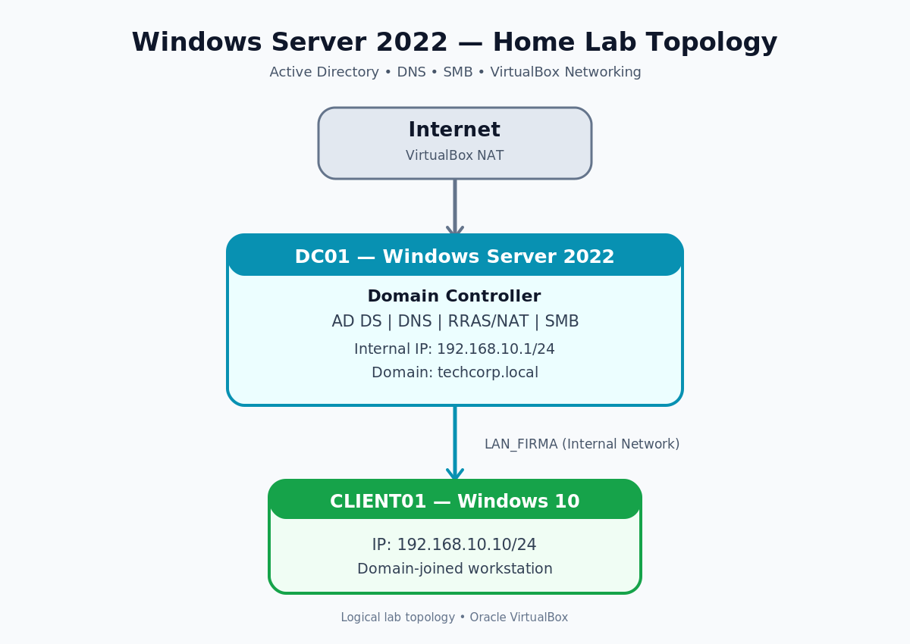
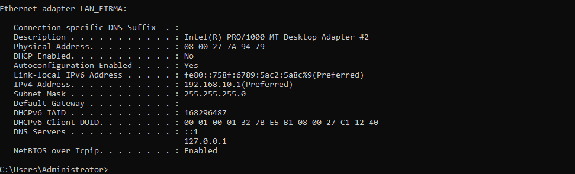
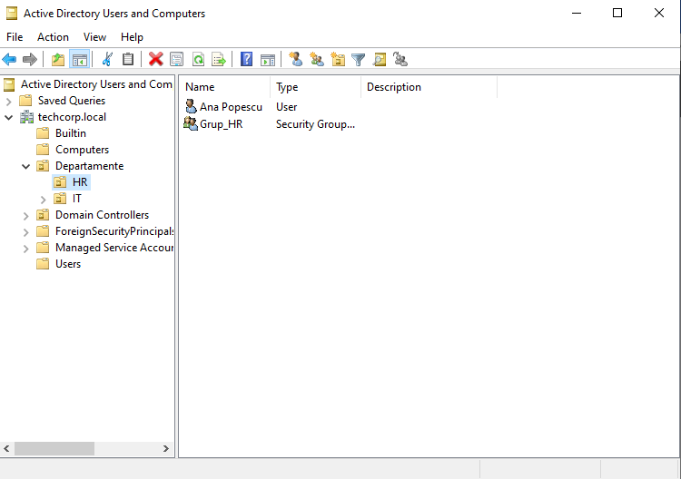
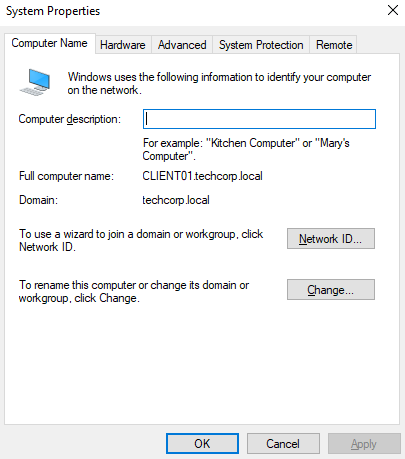
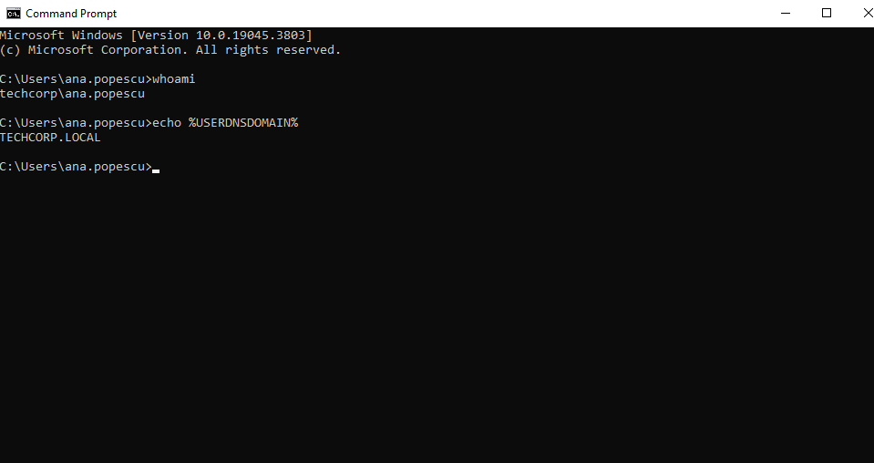
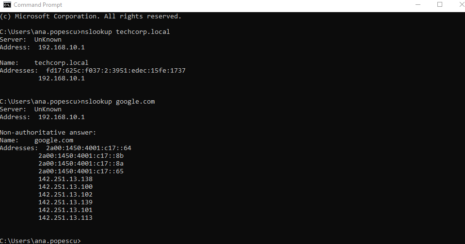
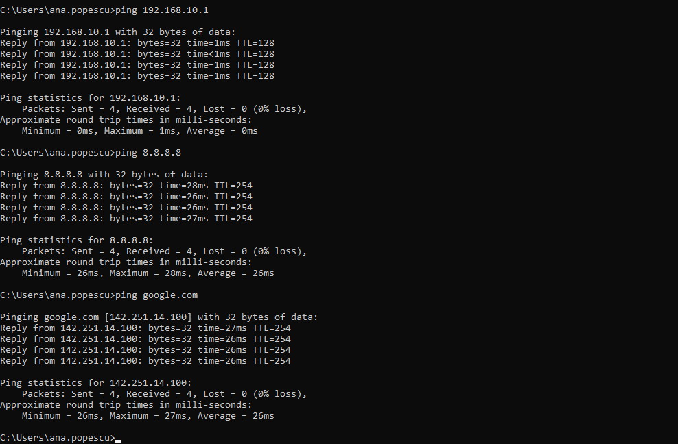
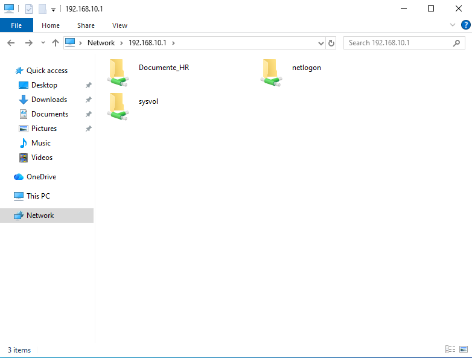
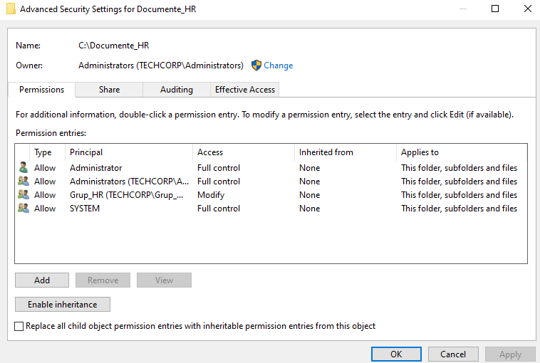
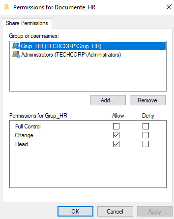

# Windows Server 2022 & Active Directory Home Lab

## Overview

This project documents a personal IT infrastructure lab created
using Windows Server 2022, Windows 10, and Oracle VirtualBox.

The goal was to practice system administration, Active Directory
management, network configuration, troubleshooting, and
SMB file sharing in a virtual environment.

## Lab Environment

| Component | Configuration |
|---|---|
| Hypervisor | Oracle VirtualBox |
| Server OS | Windows Server 2022 |
| Client OS | Windows 10 |
| Active Directory Domain | techcorp.local |
| Internal Network | LAN_FIRMA |
| Server IP | 192.168.10.1/24 |
| Client IP | 192.168.10.10/24 |
| Server Services | AD DS, DNS, RRAS/NAT, SMB |
| IP Configuration | Static addressing |

## Network Architecture

The lab consists of two virtual machines:

- **Windows Server 2022:** Domain controller providing Active
  Directory, DNS, and shared resources.
- **Windows 10:** Domain-joined client used to test
  authentication, connectivity, and resource access.

The server has an internal network adapter and a separate
VirtualBox NAT adapter for external connectivity.



## 1. Network Configuration

Configured a static IPv4 address on the server's internal
network interface.

**Server address:** 192.168.10.1  
**Subnet mask:** 255.255.255.0



## 2. Active Directory Domain Services

Configured the `techcorp.local` domain and organized
domain resources using Organizational Units (OUs).

The lab includes:

- `Departamente` organizational unit
- `HR` and `IT` organizational units
- A test domain user
- `Grup_HR` security group



## 3. Domain Join and Authentication

Joined the Windows 10 client to the `techcorp.local`
domain.

Verified the domain membership through Windows
System Properties.



Verified that the client session was running under
the domain user account using:

```cmd
whoami
echo %USERDNSDOMAIN%
```




## 4. DNS Configuration and Testing

Configured Windows Server DNS to support name resolution
within the Active Directory domain.

Tested internal and external DNS resolution using:

```cmd
nslookup techcorp.local
nslookup google.com
```

Both queries returned successful DNS responses.



**Known configuration issue:**

The internal domain currently resolves to multiple
IP addresses, including `10.0.2.15`, which appears
to be associated with the server's VirtualBox NAT
adapter.

The unwanted DNS registration has not yet been
fully resolved and remains a future troubleshooting
task.

## 5. Network Connectivity

Tested connectivity from the Windows 10 client to
the server and external destinations:

```cmd
ping 192.168.10.1
ping 8.8.8.8
ping google.com
```

All three tests received four responses with
0% packet loss during the captured tests.



## 6. SMB File Sharing

Configured a shared folder named `Documente_HR`
on Windows Server.

The folder is accessible over the network at:

```text
\\192.168.10.1\Documente_HR
```

Confirmed that the share is visible from
the Windows 10 client.



### Share Permissions

Configured `Grup_HR` with Read and Change permissions.



### NTFS Permissions

Configured NTFS permissions for the HR security group.

The captured configuration grants Full Control at
the NTFS level, while the SMB share permissions
limit network access to Read and Change.



A future improvement is to review these permissions
according to the principle of least privilege.

## 7. Troubleshooting Experience

During the lab, I investigated problems involving:

- Domain authentication
- DNS name resolution
- Network connectivity
- Access to shared resources

This project helped me practice checking configurations,
testing connectivity, and isolating possible causes
of common infrastructure problems.

## 8. Skills Practiced

- Windows Server administration
- Active Directory Domain Services
- Organizational Units and security groups
- Domain join and user authentication
- DNS configuration and troubleshooting
- TCP/IP networking
- VirtualBox networking
- SMB file sharing and permissions
- System and network troubleshooting


## Future Improvements

- Add a network topology diagram.
- Document an SMB file creation and modification test.
- Review NTFS permissions using the principle of least privilege.
- Explore Group Policy configuration and testing.

## Note

This project was created in a virtual lab environment
for educational and personal learning purposes.
